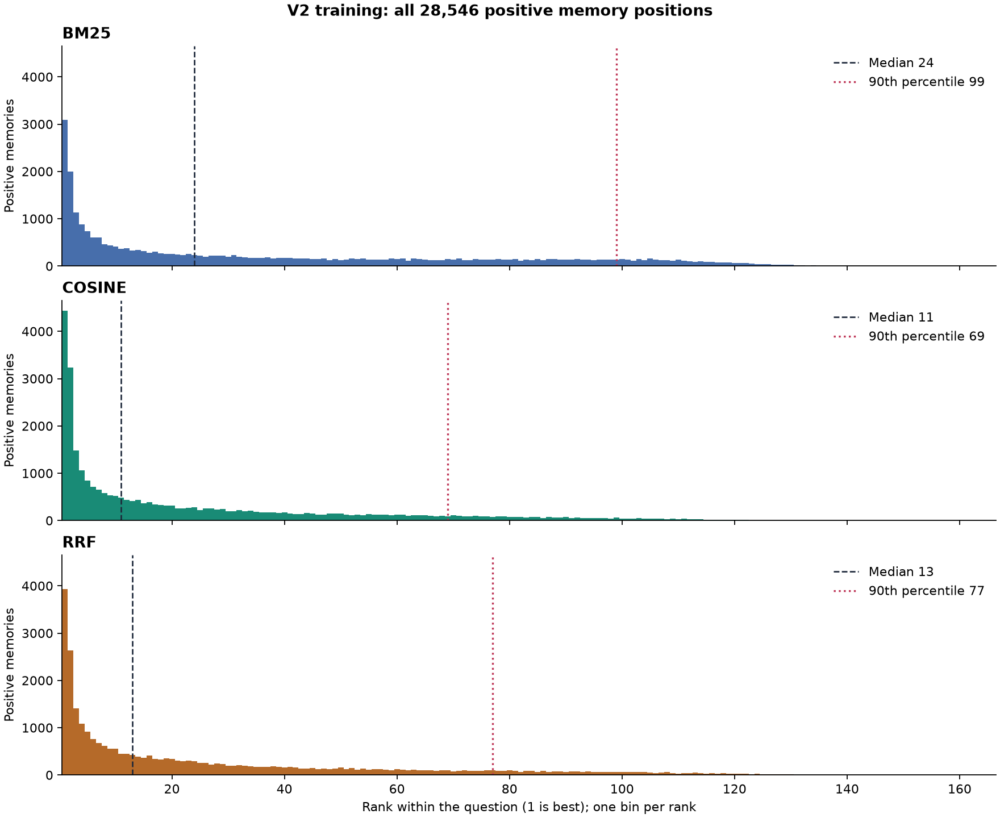

# Training retrieval diagnostics

18,532 questions, 2,144,257 question-memory examples, 28,546 positive memories. RRF constant: 60.

Positives are annotated memory pairs or standalone messages. Metrics below average questions equally. Rank percentiles pool every positive occurrence; percentile interpolation is linear.

| Method | Median positive rank | 90th percentile |
| --- | ---: | ---: |
| bm25 | 24 | 99 |
| cosine | 11 | 69 |
| rrf | 13 | 77 |

| Method | k | Recall@k | Hit@k | Full-reference coverage@k |
| --- | ---: | ---: | ---: | ---: |
| bm25 | 5 | 25.91% | 33.39% | 18.52% |
| bm25 | 10 | 34.98% | 43.16% | 26.94% |
| bm25 | 20 | 46.45% | 55.13% | 37.93% |
| bm25 | 30 | 54.77% | 63.68% | 46.02% |
| bm25 | 50 | 67.04% | 75.57% | 58.61% |
| cosine | 5 | 35.01% | 39.88% | 30.23% |
| cosine | 10 | 46.29% | 51.39% | 41.35% |
| cosine | 20 | 60.96% | 66.77% | 55.25% |
| cosine | 30 | 70.45% | 76.25% | 64.68% |
| cosine | 50 | 82.43% | 87.14% | 77.59% |
| rrf | 5 | 32.69% | 39.76% | 25.73% |
| rrf | 10 | 44.40% | 51.83% | 37.14% |
| rrf | 20 | 58.67% | 65.85% | 51.65% |
| rrf | 30 | 68.58% | 75.13% | 62.10% |
| rrf | 50 | 80.76% | 86.67% | 74.77% |

Recall@k is the fraction of a question's positive memories retrieved in its top k; Hit@k indicates at least one positive; full-reference coverage indicates all positive memories. Cutoffs larger than the candidate pool include the whole pool.

Score ties use original chronological memory order. RRF uses all candidates and depends only on the two input rankings. Labels are applied after ranking. Duplicate/missing candidates, nonfinite scores, inconsistent ranks, missing questions and zero-positive questions cause errors.

Files: metrics.csv, per_question.jsonl, positive_ranks.jsonl, positive_rank_histogram.csv, summary.json.

